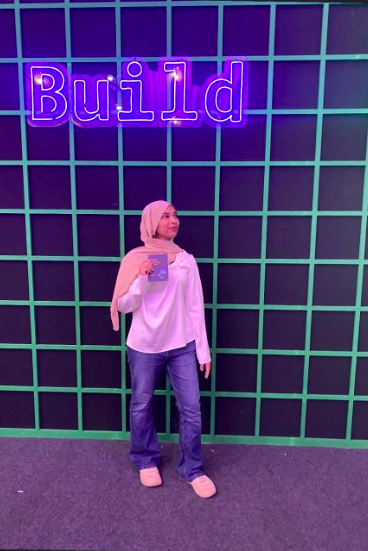
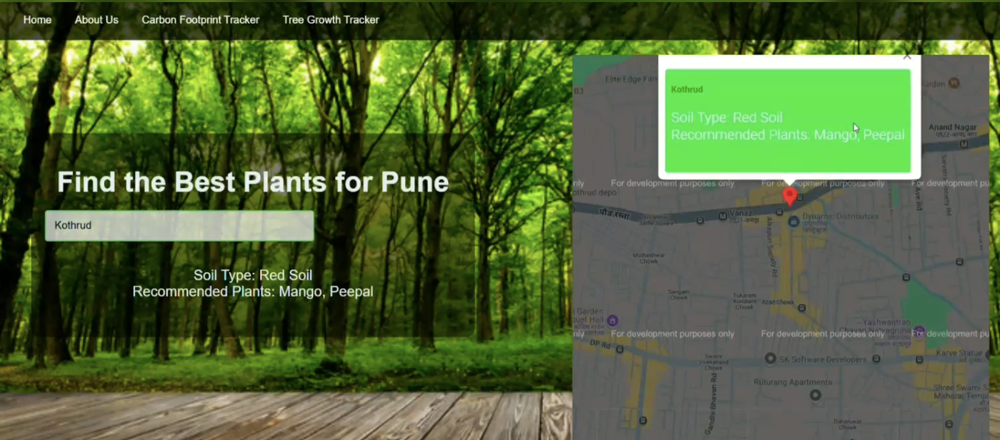
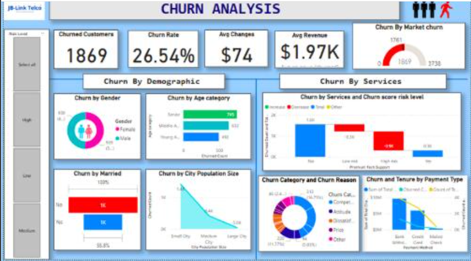
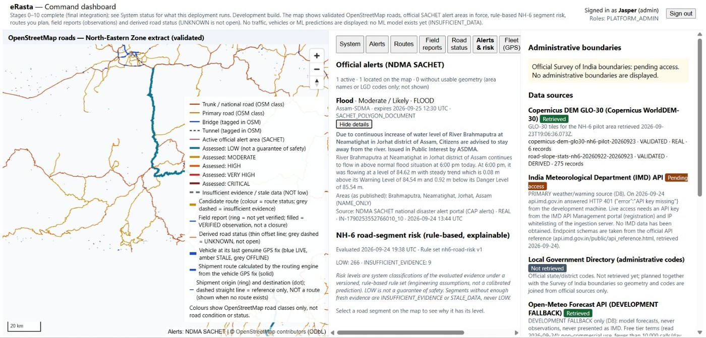

# ✦ ZIYA SHAIKH

### Data Science · Development · Problem Solving

&nbsp;&nbsp;

---

## ✦ About Me

<table>
<tr>
<td width="35%" align="center" valign="middle">

</td>
<td width="65%" valign="middle">

Hi! I'm <strong>Ziya</strong>, an MCA student specialising in <strong>Data Science</strong>.

I'm interested in how technology can turn ideas and information into useful, real-world solutions. I enjoy working across data analytics and software development — from exploring datasets and building dashboards to creating web-based applications.

I'm always learning, experimenting with tools, and improving through hands-on projects. I value curiosity, thoughtful problem-solving, and building things that have a purpose.

<strong>Currently exploring:</strong> Data Analytics, Python, SQL, business intelligence and AI-powered tools.

</td>
</tr>
</table>

---

## ✦ Tech Stack

### Programming & Web Development

### AI & LLMs

<table>
<tr>
<td align="center" width="33%" bgcolor="#171923">
 
<strong>GitHub Copilot</strong>
</td>
<td align="center" width="33%" bgcolor="#171923">
 
<strong>AWS Bedrock</strong>
</td>
<td align="center" width="33%" bgcolor="#171923">
 
<strong>Antigravity</strong>
</td>
</tr>
<tr>
<td align="center" bgcolor="#171923">
 
<strong>Claude</strong>
</td>
<td align="center" bgcolor="#171923">
 
<strong>ChatGPT</strong>
</td>
<td align="center" bgcolor="#171923">
 
<strong>Perplexity</strong>
</td>
</tr>
</table>

### Data Analytics & Business Intelligence

<table>
<tr>
<td align="center" width="33%" bgcolor="#171923">
 
<strong>Power BI</strong>
</td>
<td align="center" width="33%" bgcolor="#171923">
 
<strong>Tableau</strong>
</td>
<td align="center" width="33%" bgcolor="#171923">
 
<strong>Databricks</strong>
</td>
</tr>
</table>

### Cloud Platforms

<table>
<tr>
<td align="center" width="50%" bgcolor="#171923">
 
<strong>Amazon Web Services</strong>
</td>
<td align="center" width="50%" bgcolor="#171923">
 
<strong>Google Cloud Platform</strong>
</td>
</tr>
</table>

### Databases & Developer Tools

---

## ✦ Featured Projects

### 01 · Reforest Today

**A web-based platform supporting reforestation awareness in Pune.**

<table>
<tr>
<td width="44%" valign="top">

</td>
<td width="56%" valign="middle">

The project helps users explore suitable plants for different areas of Pune and learn more about plantation and plant growth.

**Highlights**
- Location-based plant recommendations
- Interactive map experience
- Carbon footprint and tree growth tracking
- Plant health recognition prototype

**Tech used:** HTML, CSS, JavaScript, Python, Google Maps API.

</td>
</tr>
</table>

### 02 · Telecom Customer Churn Analysis

**A Power BI dashboard exploring customer churn patterns.**

<table>
<tr>
<td width="44%" valign="top">

</td>
<td width="56%" valign="middle">

An analytics dashboard designed to make customer churn patterns easier to understand through visual summaries.

**Highlights**
- Customer churn rate and customer counts
- Churn breakdown by demographics
- Service and payment-method analysis
- Visual comparison of customer segments

**Tech used:** Power BI, data visualisation and analytics.

</td>
</tr>
</table>

### 03 · eRasta

**Smart logistics and accessibility intelligence for the North Eastern Region of India.**

<table>
<tr>
<td width="44%" valign="top">

</td>
<td width="56%" valign="middle">

An intelligent logistics platform designed to support safer, more informed route planning in a region affected by challenging terrain and weather.

**Highlights**
- GIS-based road visualisation
- Road-risk assessment and route intelligence
- Weather and disaster-alert context
- Field reports and fleet-status views

**Achievement:** Internal Smart India Hackathon 2026 winner.

**Technologies explored:** GIS, OpenStreetMap data, routing engines and Python-based development.

</td>
</tr>
</table>

---

## ✦ GitHub

I'm using GitHub to document my learning, share projects and keep improving through consistent practice.

GitHub displays your contribution calendar automatically on your profile.

---

## ✦ Connect

  

*Curious by nature. Learning by building. Growing with every project.*

